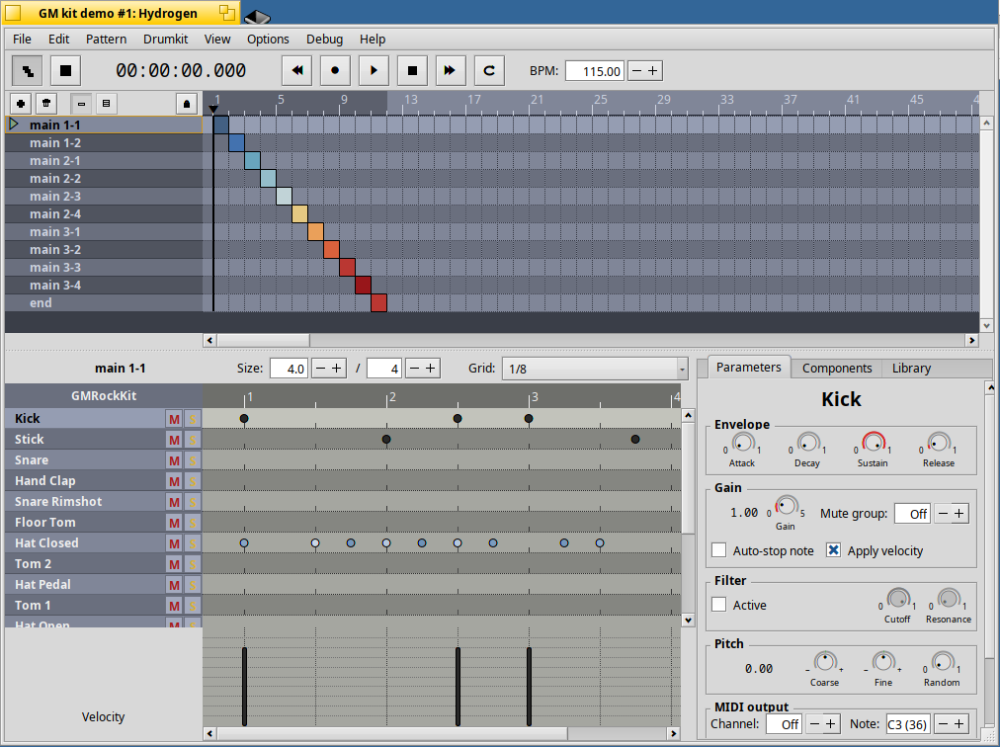
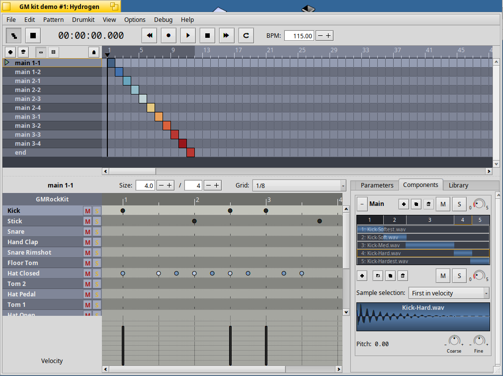
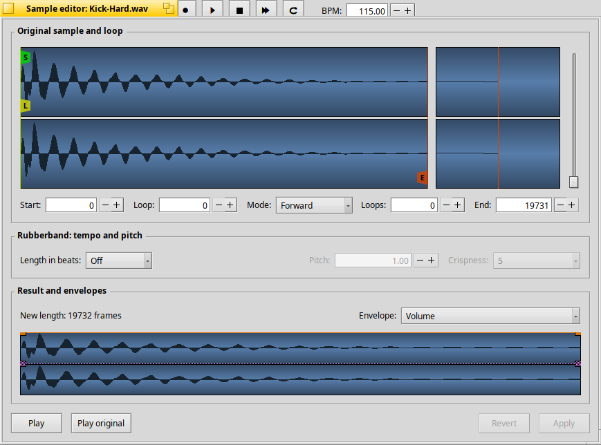
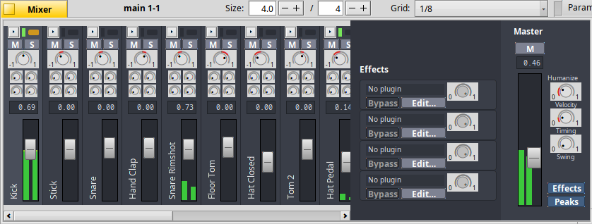
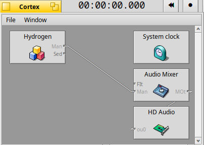
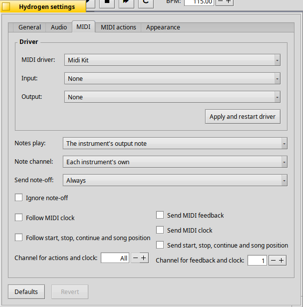

# Hydrogen for Haiku

A native [Haiku](https://www.haiku-os.org) port of [Hydrogen](http://hydrogen-music.org),
the advanced drum machine and pattern sequencer.

Upstream Hydrogen is a Qt application for Linux, macOS and Windows. This fork
keeps upstream's audio engine (the `libhydrogen-core` library) and replaces
its Qt interface with one written for the Haiku API. Audio goes through the
Media Kit and MIDI through the Midi Kit, so Hydrogen behaves like any other
Haiku program: it follows the system look, puts its settings in
`~/config/settings`, and shows up in Cortex as a node you can route.

## Download

Get the `.hpkg` from the [releases page](https://github.com/idumych/hydrogen/releases)
and install it on Haiku R1/beta6 or later:

    pkgman install ./hydrogen-2.0.0-1-x86_64.hpkg

pkgman pulls in Qt 5 (for the engine's core libraries), libsndfile and
libarchive from HaikuPorts. On a fresh system that's about 40 packages,
because HaikuPorts' Qt 5 package brings GStreamer and FFmpeg with it. The
package replaces HaikuPorts' Qt build of Hydrogen, which has the same name.

| Platform | Status |
|---|---|
| Haiku R1/beta6, x86_64 | Released (2.0.0). Tested in a QEMU VM on a fresh install: install, playback through the Media Kit, song export |
| Haiku arm64 | No package: Qt isn't available for Haiku arm64 (see "Planned") |
| Linux, macOS, Windows | Use [upstream Hydrogen](https://github.com/hydrogen-music/hydrogen) |

The engine is upstream's 2.0 development branch (pre-alpha at the time of
this release), not a released upstream version.

## What works

**Editing**
- Song editor: the pattern sequence, toggling cells by clicking and dragging,
  pattern list with its context menu, song and pattern modes, looping.
- Pattern editor: the drum grid, note velocity lane, pattern size and grid
  resolution, zoom with Alt+wheel.
- Instrument rack with three tabs:
  - *Parameters:* envelope, gain, mute group, filter, pitch, MIDI output.
  - *Components:* velocity layers, sample selection mode, waveform, per-layer
    gain and pitch, adding samples from a file panel.
  - *Library:* drumkits, songs and patterns; double-click to load.
- Sample editor (double-click a waveform): start, loop and end markers, loop
  modes, Rubberband time-stretching and pitch, volume and pan envelopes,
  preview, Apply and Revert.
- Song, pattern and drumkit properties: name, version, author, licence,
  notes, tags, image, instrument types.
- Undo and redo (Alt+Z, Alt+Shift+Z) for edits to songs, patterns, kits and
  layers.
- Autosave with recovery after a crash.

**Mixing**
- Mixer window: a strip per instrument (mute, solo, pan, four effect sends,
  fader, meter), the master section with humanize and swing.
- LADSPA effects: four effect slots, each with a window listing the installed
  plugins, a fader per control and a meter per output.

**Drumkits**
- Open any installed kit, start a new one, save, save as, export to an
  `.h2drumkit` file and import one.

**Files**
- Open, save, recent songs, demo songs.
- Export a song to WAV, FLAC, Ogg, Opus, MP3, AIFF, AU or CAF, as one file,
  one file per instrument, or both.
- Export to a MIDI file (SMF0 and SMF1) and to LilyPond.

**Audio and MIDI**
- Media Kit: Hydrogen is a node with two outputs. "Main" goes to the system
  mixer; "Send" carries the same mix for recorders and other programs, like a
  JACK client's outputs.
- Midi Kit: input and output ports, MIDI notes playing instruments, MIDI clock
  and transport in and out. Hydrogen reconnects when a program it's linked
  to restarts.
- MIDI learn: Shift-click a mixer control or transport button and move a
  controller to bind it. Settings ▸ MIDI actions lists and edits every
  binding.
- Plays along with [PowerMix](https://github.com/idumych/powermix): with
  PowerMix's MIDI clock as input, each take starts Hydrogen after the
  count-in at PowerMix's tempo.

**Haiku conventions**
- Menus, wording and shortcuts follow the Haiku Human Interface Guidelines.
  Settings… is in the File menu (Alt+,), Redo is Alt+Shift+Z, and labels use
  sentence case.
- The editors use Hydrogen's colour theme by default, or the system colours
  (Settings ▸ Appearance).
- Window sizes and positions are remembered.
- User songs, kits and patterns live in `~/config/settings/Hydrogen/data`.

## Planned

Menu items for the first few of these are already in the menus, shown
disabled.

**Next**
- Space to start and stop playback.
- Playlist editor and the director window.
- Timeline: tempo markers and tags in the song editor.
- Automation path and playback track.
- Undo history window.
- Online import of drumkits and patterns.
- Debug menu: audio engine and filesystem info, opening the log.
- Fix the export window growing when the export finishes.

**Later**
- Song editor: selecting, moving and copying cells.
- Library: properties, duplicate, delete, import and export from the Library
  tab.
- Components tab: reordering layers by dragging, dropping sample files on it.
- Mixer settings (pan law) and the beat counter.
- One Media Kit output per instrument, like upstream's JACK track outputs.
- Translations through Haiku's locale kit.
- A core without Qt. This would drop the 40-package dependency and make an
  arm64 package possible.

## Building from source

On Haiku R1/beta6:

    pkgman install cmake qt5_devel qt5_tools libsndfile_devel libarchive_devel \
        zlib_devel ladspa_sdk_devel cppunit_devel
    git clone -b haiku-native https://github.com/idumych/hydrogen.git
    cd hydrogen
    mkdir build && cd build
    cmake .. && make Hydrogen tests
    H2_SYS_DATA=$PWD/../data src/haiku/Hydrogen

`H2_SYS_DATA` points the app at the source tree's data folder (drumkits,
demo songs) instead of the installed one. `sh packaging/build-hpkg.sh`
builds the package, runs the core's unit tests, and writes
`hydrogen-<version>-1-x86_64.hpkg`.

The native interface lives in `src/haiku/`. `src/haiku/REFERENCE.md`
documents each window, where it differs from upstream, and the upstream bugs
fixed along the way. The Media Kit and Midi Kit drivers are in `src/core/IO/`.

## Credits and licence

Hydrogen is written by [the Hydrogen development team](AUTHORS), 2002–2026.
The Haiku port is by [idumych](https://github.com/idumych). This is a fork,
not an official upstream release; report Haiku-specific problems
[here](https://github.com/idumych/hydrogen/issues).

GNU General Public License, version 2 or later. See [COPYING](COPYING).
